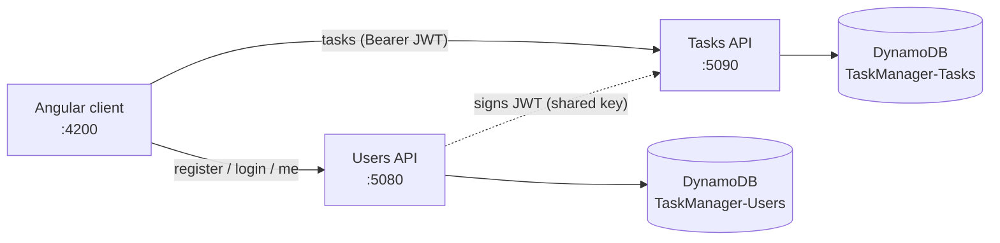
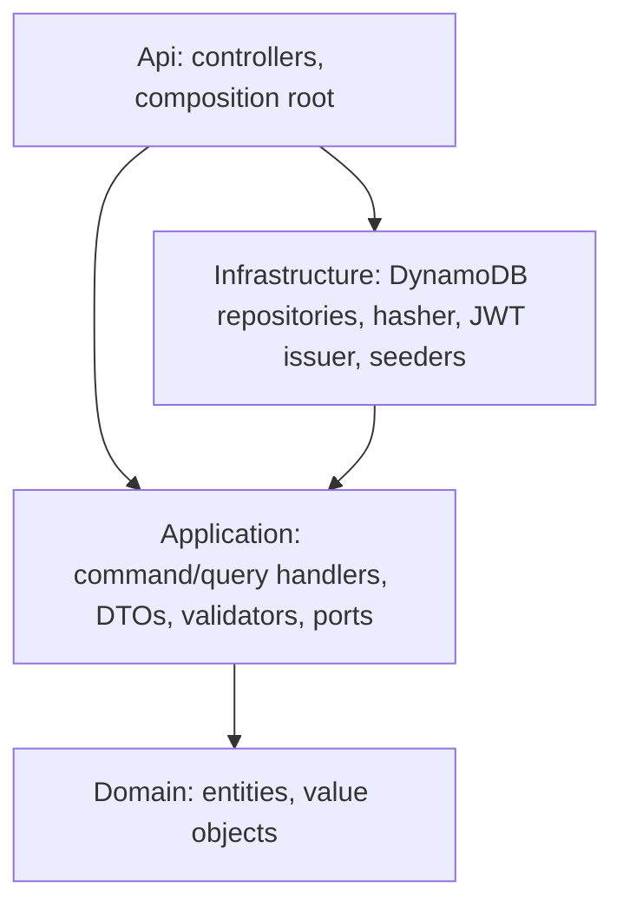

# TaskManager

A task-management application: users register, sign in, and create, list and update **their own** tasks. It is made of a **Users API**, a **Tasks API** (both ASP.NET Core on .NET 10), one **DynamoDB** table per API, and an **Angular 22** client.

This repository delivers sub-project 1 (foundation plus Story 1, "Sign in and add my first task", merged) Story 2 ("See my tasks", merged) and Story 4 ("Update a task", in review). Further stories, such as task delete, are pending. AWS deployment and continuous deployment are sub-project 3 (pending).

| Capability | Status |
|---|---|
| Register, sign in, `GET /users/me` | Done |
| Create, list (newest first), get a task | Done |
| Update a task, move it between To do, In progress and Done | In review (Story 4) |
| Delete a task | Pending (Story 5) |
| AWS deployment and CD | Pending (sub-project 3) |

## Project status

| Work | Status |
|---|---|
| Sub-project 1: foundation and Story 1 (sign in, add my first task) | Merged in #29 (follow-ups #30, #31) |
| Story 2 (#16): see my tasks, newest first, no pagination | Merged in #32 |
| Story 3 (#17): describe my task fully | Pending (criteria already met in code; evidence to add) |
| Story 4 (#18): update a task (edit, move between statuses) | In review; spec and plan in `docs/superpowers/` |
| Stories 5-9 (#19-#23) | Pending |
| AWS deployment and CD (sub-project 3) | Pending |

Last updated: 2026-11-10

## Architecture



The Tasks API never reads the Users table. It trusts the `sub` claim of a JWT signed by the Users API with a shared signing key.

Each API follows Clean Architecture with CQRS-style use cases: Controller → command/query handler → Repository. Each use case is a command (changes state) or a query (read only) with one handler that implements `ICommandHandler` or `IQueryHandler`. Controllers inject the handler they need directly, so there is no mediator. There is no EF, Dapper or MediatR.



Domain and Application reference no `Amazon.*` or `Microsoft.AspNetCore.*` packages, and only `*.Api` references `*.Infrastructure`. NetArchTest tests in `tests/TaskManager.ArchitectureTests` enforce this.

Key design points (full detail in `docs/superpowers/specs/2026-11-10-story-1-foundation-design.md`):

- **Users table** (`TaskManager-Users`, pk `pk`) holds `USER#<guid>` items and `EMAIL#<normalized email>` guard items. Registration writes both in one `TransactWriteItems`, which makes email uniqueness safe under concurrency (a GSI cannot enforce uniqueness). Login uses two strongly consistent `GetItem` calls.
- **Tasks table** (`TaskManager-Tasks`, pk `userId`, sk `_id`) means ownership is enforced by the key. Another user's task returns `404`.
- **Auth**: JWT HS256, 60 minutes, issuer `taskmanager-users`, audience `taskmanager-api`. Wrong email and wrong password give the same `401`. Login and register are each limited to 5 requests per minute per IP, in separate buckets (`429`).
- **Observability**: Serilog JSON logs with `X-Correlation-Id` (CloudWatch Logs when deployed) and CloudWatch Embedded Metric Format metrics. Passwords, hashes and tokens are never logged.

## Prerequisites

- .NET SDK 10.0.401 or newer (see `global.json`)
- Node.js LTS and npm
- Docker (DynamoDB Local and the backend integration tests)

## Quick start

```bash
# 1. DynamoDB Local on :8000 and the admin UI on :8001
docker compose up -d

# 2. The SAME signing key (32+ characters) on BOTH APIs
dotnet user-secrets set Jwt:SigningKey "<32+ char value>" --project src/Users/TaskManager.Users.Api
dotnet user-secrets set Jwt:SigningKey "<32+ char value>" --project src/Tasks/TaskManager.Tasks.Api

# 3. Run the APIs (separate terminals). Development creates tables and seeds demo data.
dotnet run --project src/Users/TaskManager.Users.Api    # http://localhost:5080
dotnet run --project src/Tasks/TaskManager.Tasks.Api    # http://localhost:5090

# 4. Run the client
cd web && npm ci && npm start                           # http://localhost:4200
```

A missing or too-short key makes the API fail at startup. `.claude/launch.json` defines `users-api`, `tasks-api` and `web` dev-server configurations for Claude Code's preview tooling.

### Demo credentials

`demo@taskmanager.dev` / `Demo123!` (the login page also has a "Use demo account" button). The demo user has a few seeded tasks.

## Running tests

```bash
dotnet build TaskManager.slnx -warnaserror
dotnet test TaskManager.slnx

cd web
npx ng lint
npx ng test --watch=false
npx ng build
```

Repository integration tests use Testcontainers, which needs a current Docker (API 1.44 or newer). With an older Docker, start DynamoDB Local and point the tests at it:

```bash
docker compose up -d
DYNAMODB_TEST_ENDPOINT=http://localhost:8000 dotnet test TaskManager.slnx
```

Coverage (Domain and Application must stay at 80% line coverage or higher; CI enforces this):

```bash
dotnet test TaskManager.slnx --collect:"XPlat Code Coverage" --settings coverlet.runsettings --results-directory ./coverage-raw
dotnet tool restore
dotnet tool run reportgenerator "-reports:coverage-raw/**/coverage.cobertura.xml" "-targetdir:coverage-report" "-reporttypes:Html;TextSummary" "-assemblyfilters:+TaskManager.*.Domain;+TaskManager.*.Application"
```

The measured line coverage on Domain and Application is 98.5%.

## Configuration reference

Set through `appsettings*.json`, user-secrets or environment variables (`Section__Key`).

| Section | Key | Default / note |
|---|---|---|
| `Dynamo` | `ServiceUrl` | unset = real AWS; Development uses `http://localhost:8000` |
| | `Region` | `us-east-1` |
| | `TableName` | `TaskManager-Users` / `TaskManager-Tasks` |
| | `CreateTablesIfMissing` | `false`; `true` in Development (in AWS, tables come from IaC) |
| `Jwt` | `SigningKey` | **required**, at least 32 bytes, never committed; must be identical on both APIs |
| | `Issuer`, `Audience` | `taskmanager-users`, `taskmanager-api` |
| | `LifetimeMinutes` | `60` |
| `Seed` | `Enabled` | `false`; `true` in Development. Seeding is idempotent, and enabling it outside Development fails startup (the demo password is public) |
| | `DemoUserId`, `DemoEmail`, `DemoPassword`, `DemoFullName` | fixed demo user (`11111111-1111-1111-1111-111111111111`) |
| `Cors` | `AllowedOrigins` | `["http://localhost:4200"]` |
| `RateLimiting` | `LoginPermitLimit`, `RegisterPermitLimit` | `5` per minute per IP each (Users API only) |
| `ForwardedHeaders` | `KnownProxies`, `KnownNetworks` | unset = `X-Forwarded-For` ignored; set to the proxy IPs or CIDR ranges (CloudFront, ALB) to rate-limit and log the real client IP |

The client reads `web/public/config.json` at startup, so one build runs in any environment:

```json
{ "usersApiUrl": "http://localhost:5080", "tasksApiUrl": "http://localhost:5090" }
```

## API overview

Interactive docs (Scalar, Development only): `http://localhost:5080/scalar/v1` and `http://localhost:5090/scalar/v1`.

| API | Method and route | Auth | Notes |
|---|---|---|---|
| Users | `POST /api/v1/auth/register` | anonymous | `201`, `400`, `409` (email taken), `429`, `503` (concurrent registration of the same email; retry) |
| Users | `POST /api/v1/auth/login` | anonymous | `200` with `accessToken`, `400`, `401`, `429`, `503` (no client IP; hosting misconfiguration) |
| Users | `GET /api/v1/users/me` | JWT | current user; the client also uses it to validate a stored session |
| Tasks | `POST /api/v1/tasks` | JWT | `201`, `400`, `401` |
| Tasks | `GET /api/v1/tasks` | JWT | caller's tasks, newest first |
| Tasks | `GET /api/v1/tasks/{id}` | JWT | `404` for missing or another user's task |
| Tasks | `PUT /api/v1/tasks/{id}` | JWT | `200`, `400` (same rules as create; `status` required), `401`, `404` |
| Both | `GET /health`, `GET /health/ready` | anonymous | liveness and readiness (DynamoDB `DescribeTable`) |

Errors are RFC 9457 ProblemDetails. Malformed JSON, a missing body or an unknown `status` return `400`, never `500`.

## Project layout

```
src/BuildingBlocks/   SharedKernel (Result, Error, IClock), ApiCommon (web plumbing), Infrastructure.DynamoDb
src/Users/            Domain, Application, Infrastructure, Api
src/Tasks/            Domain, Application, Infrastructure, Api
tests/                one test project per src project, TaskManager.Testing (helpers), ArchitectureTests
web/                  Angular client (core/, layout/, features/, shared/)
docs/superpowers/     design spec and implementation plan
.github/workflows/    ci.yml, pr-review.yml
.claude/              rules/rules.md (collaborator rules), launch.json (dev-server configs)
```

## CI and PR review

`.github/workflows/ci.yml` runs on every pull request and on pushes to `main`:

- **backend**: restore, `dotnet build -warnaserror`, tests with coverage, and the 80% Domain + Application line-coverage gate.
- **frontend**: `npm ci`, `ng lint --max-warnings 0`, `ng test`, `ng build`.
- **repo-hygiene**: fails if any tracked file is a symbolic link.

`.github/workflows/pr-review.yml` has Claude review each PR with fresh eyes against `.claude/rules/rules.md`. It is comment-only: it never approves, resolves threads or merges, and a human does that.

### One-time setup (repository owner)

1. **AI review secret** (uses a Claude Pro/Max subscription, not API billing):
   - Locally, run `claude setup-token` and copy the token it prints.
   - Settings → Secrets and variables → Actions → New repository secret named `CLAUDE_CODE_OAUTH_TOKEN`, or run `gh secret set CLAUDE_CODE_OAUTH_TOKEN --repo <owner>/TaskManager`.
   - Without it the review job skips itself. Comments are posted with the job's own `GITHUB_TOKEN` as `github-actions[bot]`.
2. **Branch protection on `main`**: Settings → Branches → add a rule for `main` that:
   - requires a pull request before merging, with at least 1 approval from a human, and dismisses stale approvals;
   - requires status checks `backend`, `frontend` and `repo-hygiene` to pass, with branches up to date;
   - blocks direct pushes (and force pushes and deletions).

   These settings are not applied by the repository's code; the owner must set them.

## Known limitations

- **No email verification**: accounts are active immediately (Amazon SES sandbox friction; can be added as a later story).
- **No refresh tokens**: the access token lasts 60 minutes, then the user signs in again.
- **Token in `sessionStorage`**: simple across two separately hosted APIs, but exposed to XSS; an httpOnly cookie would resist it better.
- **No end-to-end browser test suite** (unit and integration tests only).
- **Browser console and wrong passwords**: a failed login returns `401` by design, and the browser itself logs "Failed to load resource: 401" for it. The app code emits no warnings or errors; the browser's own network log line cannot be suppressed without breaking the API contract.
- No pagination parameters on the list endpoint; no password reset.
- **Rate limits are per instance and per IP**: behind a proxy such as CloudFront, set `ForwardedHeaders:KnownProxies` or `KnownNetworks` (spec section 11).
- **Deployment pending**: AWS hosting and CD are sub-project 3. Task update and delete are later stories.
