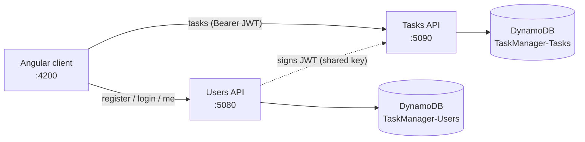
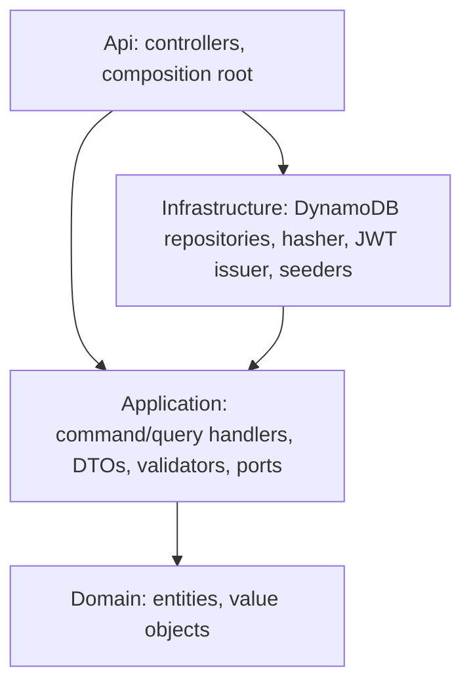
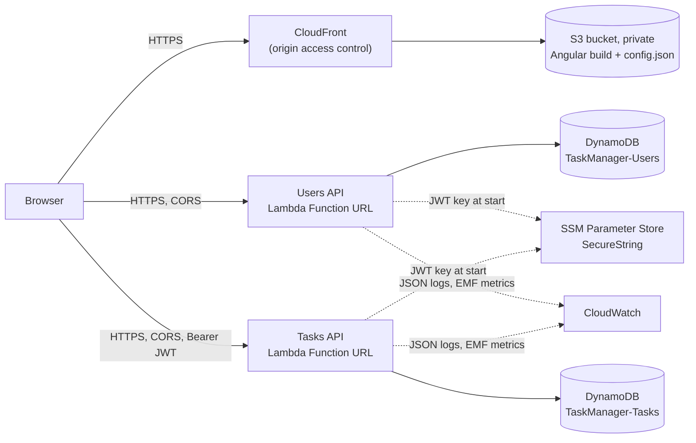

# TaskManager

A task-management application: users register, sign in, and create, list and update **their own** tasks. It is made of a **Users API**, a **Tasks API** (both ASP.NET Core on .NET 10), one **DynamoDB** table per API, and an **Angular 22** client.

This repository delivers sub-project 1 (foundation plus Story 1, "Sign in and add my first task") and Stories 2-5 ("See my tasks", "Describe my task fully", "Update a task", "Delete a task"), all merged. Story 6 ("Create my own account") is merged. Story 9 ("Use TaskManager over the internet": AWS deployment and continuous deployment) is in review, and the remaining stories are pending.

| Capability | Status |
|---|---|
| Register, sign in, `GET /users/me` | Done (Story 6) |
| Create, list (newest first), get a task | Done |
| Describe a task (description, status, due date) | Done (Story 3) |
| Update a task, move it between To do, In progress and Done | Done (Story 4) |
| Delete a task, with confirmation | Done (Story 5) |
| Public deployment on AWS, CD on merge and on demand | In review (Story 9) |

## Project status

| Work | Status |
|---|---|
| Sub-project 1: foundation and Story 1 (sign in, add my first task) | Merged in #29 (follow-ups #30, #31) |
| Story 2 (#16): see my tasks, newest first, no pagination | Merged in #32 |
| Story 3 (#17): describe my task fully | Merged in #33 |
| Story 4 (#18): update a task (edit, move between statuses) | Merged in #35 |
| Story 5 (#19): delete a task, with confirmation | Merged in #36 |
| Story 6 (#20): create my own account | Merged in #37 |
| Story 9 (#38): use TaskManager over the internet (AWS deployment and CD) | In review on `feature/story-9-use-over-the-internet`; first deployment waits for the one-time AWS setup |
| Remaining stories (#21-#23, #34) | Pending |

Last updated: 2026-11-11

## Architecture



The Tasks API never reads the Users table. It trusts the `sub` claim of a JWT signed by the Users API with a shared signing key.

Each API follows Clean Architecture with CQRS-style use cases: Controller → command/query handler → Repository. Each use case is a command (changes state) or a query (read only) with one handler that implements `ICommandHandler` or `IQueryHandler`. Controllers inject the handler they need directly, so there is no mediator. There is no EF, Dapper or MediatR.



Domain and Application reference no `Amazon.*` or `Microsoft.AspNetCore.*` packages, and only `*.Api` references `*.Infrastructure`. NetArchTest tests in `tests/TaskManager.ArchitectureTests` enforce this.

Key design points (full detail in `docs/superpowers/specs/2026-11-10-story-1-foundation-design.md`):

- **Users table** (`TaskManager-Users`, pk `pk`) holds `USER#<guid>` items and `EMAIL#<normalized email>` guard items. Registration writes both in one `TransactWriteItems`, which makes email uniqueness safe under concurrency (a GSI cannot enforce uniqueness). Login uses two strongly consistent `GetItem` calls.
- **Tasks table** (`TaskManager-Tasks`, pk `userId`, sk `_id`) means ownership is enforced by the key. Another user's task returns `404`.
- **Auth**: JWT HS256, 60 minutes, issuer `taskmanager-users`, audience `taskmanager-api`. Wrong email and wrong password give the same `401`. Login and register are each limited to 5 requests per minute per IP, in separate buckets (`429`).
- **Observability**: Serilog JSON logs with `X-Correlation-Id` (CloudWatch Logs when deployed) and CloudWatch Embedded Metric Format metrics. Passwords, hashes and tokens are never logged.

## Prerequisites

- .NET SDK 10.0.401 or newer (see `global.json`)
- Node.js LTS and npm
- Docker (DynamoDB Local and the backend integration tests)

## Quick start

```bash
# 1. DynamoDB Local on :8000 and the admin UI on :8001
docker compose up -d

# 2. The SAME signing key (32+ characters) on BOTH APIs
dotnet user-secrets set Jwt:SigningKey "<32+ char value>" --project src/Users/TaskManager.Users.Api
dotnet user-secrets set Jwt:SigningKey "<32+ char value>" --project src/Tasks/TaskManager.Tasks.Api

# 3. Run the APIs (separate terminals). Development creates tables and seeds demo data.
dotnet run --project src/Users/TaskManager.Users.Api    # http://localhost:5080
dotnet run --project src/Tasks/TaskManager.Tasks.Api    # http://localhost:5090

# 4. Run the client
cd web && npm ci && npm start                           # http://localhost:4200
```

A missing or too-short key makes the API fail at startup. `.claude/launch.json` defines `users-api`, `tasks-api` and `web` dev-server configurations for Claude Code's preview tooling.

### Demo credentials

`demo@taskmanager.dev` / `Demo123!` (the login page also has a "Use demo account" button). The demo user has a few seeded tasks.

On the deployed site the same demo user exists with a **private password** (from SSM, shared only with reviewers), and the login page does not show the demo option.

## Running tests

```bash
dotnet build TaskManager.slnx -warnaserror
dotnet test TaskManager.slnx

cd web
npx ng lint
npx ng test --watch=false
npx ng build
```

Repository integration tests use Testcontainers, which needs a current Docker (API 1.44 or newer). With an older Docker, start DynamoDB Local and point the tests at it:

```bash
docker compose up -d
DYNAMODB_TEST_ENDPOINT=http://localhost:8000 dotnet test TaskManager.slnx
```

Coverage (Domain and Application must stay at 80% line coverage or higher; CI enforces this):

```bash
dotnet test TaskManager.slnx --collect:"XPlat Code Coverage" --settings coverlet.runsettings --results-directory ./coverage-raw
dotnet tool restore
dotnet tool run reportgenerator "-reports:coverage-raw/**/coverage.cobertura.xml" "-targetdir:coverage-report" "-reporttypes:Html;TextSummary" "-assemblyfilters:+TaskManager.*.Domain;+TaskManager.*.Application"
```

The measured line coverage on Domain and Application is 98.5%.

## Configuration reference

Set through `appsettings*.json`, user-secrets or environment variables (`Section__Key`).

| Section | Key | Default / note |
|---|---|---|
| `Dynamo` | `ServiceUrl` | unset = real AWS; Development uses `http://localhost:8000` |
| | `Region` | `us-east-1` |
| | `TableName` | `TaskManager-Users` / `TaskManager-Tasks` |
| | `CreateTablesIfMissing` | `false`; `true` in Development (in AWS, tables come from IaC) |
| `Jwt` | `SigningKey` | **required**, at least 32 bytes, never committed; must be identical on both APIs |
| | `SigningKeyParameterName` | unset locally; in AWS `/taskmanager/jwt-signing-key`, an SSM SecureString read at startup into `SigningKey` (a configured `SigningKey` wins) |
| | `Issuer`, `Audience` | `taskmanager-users`, `taskmanager-api` |
| | `LifetimeMinutes` | `60` |
| `Seed` | `Enabled` | `false`; `true` in Development and in AWS. Seeding is idempotent. Outside Development it requires a private `DemoPassword`: the public default or a blank one fails startup |
| | `DemoUserId`, `DemoEmail`, `DemoPassword`, `DemoFullName` | fixed demo user (`11111111-1111-1111-1111-111111111111`); `DemoPassword` defaults to the public `Demo123!` |
| | `DemoPasswordParameterName` | unset locally; in AWS `/taskmanager/demo-password`, an SSM SecureString read at startup into `DemoPassword` (Users API) |
| `Cors` | `AllowedOrigins` | `["http://localhost:4200"]` |
| `RateLimiting` | `LoginPermitLimit`, `RegisterPermitLimit` | `5` per minute per IP each (Users API only) |
| `ForwardedHeaders` | `KnownProxies`, `KnownNetworks` | unset = `X-Forwarded-For` ignored; set to the proxy IPs or CIDR ranges (CloudFront, ALB) to rate-limit and log the real client IP |

The client reads `web/public/config.json` at startup, so one build runs in any environment:

```json
{ "usersApiUrl": "http://localhost:5080", "tasksApiUrl": "http://localhost:5090", "demoAccount": true }
```

`demoAccount` shows the demo credentials on the login page. The deployed `config.json` is generated with the AWS API URLs and no `demoAccount`: the demo user exists in AWS, but its password is private, so the page does not advertise it.

## API overview

Interactive docs (Scalar, Development only): `http://localhost:5080/scalar/v1` and `http://localhost:5090/scalar/v1`.

| API | Method and route | Auth | Notes |
|---|---|---|---|
| Users | `POST /api/v1/auth/register` | anonymous | `201`, `400`, `409` (email taken), `429`, `503` (concurrent registration of the same email; retry) |
| Users | `POST /api/v1/auth/login` | anonymous | `200` with `accessToken`, `400`, `401`, `429`, `503` (no client IP; hosting misconfiguration) |
| Users | `GET /api/v1/users/me` | JWT | current user; the client also uses it to validate a stored session |
| Tasks | `POST /api/v1/tasks` | JWT | `201`, `400`, `401` |
| Tasks | `GET /api/v1/tasks` | JWT | caller's tasks, newest first |
| Tasks | `GET /api/v1/tasks/{id}` | JWT | `404` for missing or another user's task |
| Tasks | `PUT /api/v1/tasks/{id}` | JWT | `200`, `400` (same rules as create; `status` required), `401`, `404` |
| Both | `GET /health`, `GET /health/ready` | anonymous | liveness and readiness (DynamoDB `DescribeTable`) |

Errors are RFC 9457 ProblemDetails. Malformed JSON, a missing body or an unknown `status` return `400`, never `500`.

## Project layout

```
src/BuildingBlocks/   SharedKernel (Result, Error, IClock), ApiCommon (web plumbing), Infrastructure.DynamoDb
src/Users/            Domain, Application, Infrastructure, Api
src/Tasks/            Domain, Application, Infrastructure, Api
tests/                one test project per src project, TaskManager.Testing (helpers), ArchitectureTests
web/                  Angular client (core/, layout/, features/, shared/)
infra/                AWS CDK app (C#), cdk.json, smoke-test.sh
docs/superpowers/     design spec and implementation plan
.github/workflows/    ci.yml (build, test, deploy), pr-review.yml
.github/scripts/      changed-artifacts.sh (which artifacts a push changed)
.claude/              rules/rules.md (collaborator rules), launch.json (dev-server configs)
```

## Deployment (AWS)

The app runs on AWS free-tier services only, defined with the AWS CDK in C# (`infra/TaskManager.Infra`, tested by `tests/TaskManager.Infra.Tests`).



| Piece | AWS service | Why this one (cost) |
|---|---|---|
| Users API, Tasks API | Lambda (`dotnet10`, arm64, 1024 MB) with a public **Function URL** | No API Gateway charge; Lambda's 1M requests/month are always free |
| Data | DynamoDB, provisioned **5 RCU / 5 WCU per table** | 10 + 10 is inside the always-free 25 / 25 |
| Web client | Private S3 bucket behind **CloudFront** | CloudFront's 1 TB / 10M requests are always free; the bucket holds a few MB |
| JWT signing key, demo password | **SSM Parameter Store SecureStrings** | Free (Secrets Manager costs $0.40 per secret per month) |
| Logs and metrics | CloudWatch Logs (7-day retention), 6 EMF custom metrics | Within the 5 GB and 10-metric free allowances |
| CI/CD sign-in | GitHub OIDC → IAM role | No AWS keys stored in GitHub |

Expected cost for this exercise: **$0 per month**.

### How deployment works

- **On every merge to `main`**, the `changes` job works out which artifacts changed (`users-api`, `tasks-api`, `web`, `infra`; shared code and build settings count for both APIs) since the **last successful CI run on `main`**. Comparing against that run, not just the previous commit, keeps changes from runs that GitHub cancelled (quick successive merges) or that failed. If nothing deployable changed (for example a docs-only merge), nothing is deployed.
- Otherwise the `deploy` job runs after `backend`, `frontend` and `repo-hygiene` pass. It publishes both APIs deterministically, so unchanged code produces byte-identical output, builds the client and runs `cdk deploy`. CloudFormation then updates only the resources whose code or settings changed: an unchanged Lambda or client is left alone.
- **Manual deploy**: Actions → CI → Run workflow on `main`. The tests run first, then everything is deployed (unchanged resources are still skipped).
- After each deploy, `infra/smoke-test.sh` checks the live site (including a deep-link reload), `config.json`, both `/health/ready` endpoints, login and token rejection, and CORS from the site's origin. The job summary lists the site and API URLs.
- **Demo data**: on each cold start the APIs make sure the demo user `demo@taskmanager.dev` (private password from SSM) and its sample tasks exist. The login page does not show the demo option; reviewers sign in with the credentials you give them.
- Until the AWS setup below is done, the `deploy` job is skipped, so CI stays green.

### One-time AWS setup (repository owner)

You need an AWS account and the AWS CLI signed in as an administrator (for example `aws sso login`). The pipeline itself never uses these credentials.

```bash
# 1. The JWT signing key and the demo user's private password (SecureStrings; CloudFormation cannot create these).
#    Choose the demo password yourself and share it only with reviewers; the public Demo123! is refused.
aws ssm put-parameter --region us-east-1 --name /taskmanager/jwt-signing-key --type SecureString --value "$(openssl rand -base64 48)"
aws ssm put-parameter --region us-east-1 --name /taskmanager/demo-password --type SecureString --value '<your private demo password>'

# 2. Prepare the account for the CDK (once per account and region)
npx --yes aws-cdk@2.1148.1 bootstrap aws://<ACCOUNT_ID>/us-east-1

# 3. The GitHub OIDC deploy role (prints DeployRoleArn). If the account already has the GitHub OIDC provider,
#    add: -c githubOidcProviderArn=arn:aws:iam::<ACCOUNT_ID>:oidc-provider/token.actions.githubusercontent.com
cd infra && npx --yes aws-cdk@2.1148.1 deploy TaskManager-GitHubOidc

# 4. REQUIRED: only main may deploy. The role trusts any job in the `production` environment, and a feature
#    branch could edit ci.yml, so GitHub itself must refuse that environment to every other branch.
gh api -X PUT repos/<owner>/TaskManager/environments/production --input - <<'JSON'
{ "deployment_branch_policy": { "protected_branches": false, "custom_branch_policies": true } }
JSON
gh api -X POST repos/<owner>/TaskManager/environments/production/deployment-branch-policies -f name=main -f type=branch

# 5. Tell the workflow which role and region to use (repository variables, not secrets)
gh variable set AWS_DEPLOY_ROLE_ARN --body "<DeployRoleArn>"
gh variable set AWS_REGION --body us-east-1
```

Check step 4 under Settings → Environments → `production` → Deployment branches: only `main`. Optionally add a required reviewer there to approve each deploy.

Then run the **first deploy manually** (Actions → CI → Run workflow on `main`). Merges made before the setup ran CI successfully without deploying, so only a manual run is sure to deploy everything; after that, merges deploy what changed.

### Teardown

```bash
cd infra && npx --yes aws-cdk@2.1148.1 destroy TaskManager TaskManager-GitHubOidc
aws ssm delete-parameters --region us-east-1 --names /taskmanager/jwt-signing-key /taskmanager/demo-password
```

Tables, bucket contents and log groups are deleted with the stack.

## CI and PR review

`.github/workflows/ci.yml` runs on every pull request, on pushes to `main`, and on demand:

- **backend**: restore, `dotnet build -warnaserror`, tests with coverage, and the 80% Domain + Application line-coverage gate.
- **frontend**: `npm ci`, `ng lint --max-warnings 0`, `ng test`, `ng build`.
- **repo-hygiene**: fails if any tracked file is a symbolic link.
- **changes** (pushes to `main` and manual runs): which deployable artifacts changed.
- **deploy** (`main` only, after the jobs above pass): deploys to AWS and smoke-tests the result; see [Deployment (AWS)](#deployment-aws). It also runs from Actions → CI → Run workflow.

`.github/workflows/pr-review.yml` has Claude review each PR with fresh eyes against `.claude/rules/rules.md`. It is comment-only: it never approves, resolves threads or merges, and a human does that.

### One-time setup (repository owner)

1. **AI review secret** (uses a Claude Pro/Max subscription, not API billing):
   - Locally, run `claude setup-token` and copy the token it prints.
   - Settings → Secrets and variables → Actions → New repository secret named `CLAUDE_CODE_OAUTH_TOKEN`, or run `gh secret set CLAUDE_CODE_OAUTH_TOKEN --repo <owner>/TaskManager`.
   - Without it the review job skips itself. Comments are posted with the job's own `GITHUB_TOKEN` as `github-actions[bot]`.
2. **Branch protection on `main`**: Settings → Branches → add a rule for `main` that:
   - requires a pull request before merging, with at least 1 approval from a human, and dismisses stale approvals;
   - requires status checks `backend`, `frontend` and `repo-hygiene` to pass, with branches up to date;
   - blocks direct pushes (and force pushes and deletions).

   These settings are not applied by the repository's code; the owner must set them.

## Known limitations

- **No email verification**: accounts are active immediately (Amazon SES sandbox friction; can be added as a later story).
- **No refresh tokens**: the access token lasts 60 minutes, then the user signs in again.
- **Token in `sessionStorage`**: simple across two separately hosted APIs, but exposed to XSS; an httpOnly cookie would resist it better.
- **No end-to-end browser test suite** (unit and integration tests only).
- **Browser console and wrong passwords**: a failed login returns `401` by design, and the browser itself logs "Failed to load resource: 401" for it. The app code emits no warnings or errors; the browser's own network log line cannot be suppressed without breaking the API contract.
- No pagination parameters on the list endpoint; no password reset.
- **Rate limits are per instance and per IP**: each warm Lambda instance keeps its own counters, so the effective limit grows with concurrency. In AWS the browser calls the Lambda Function URLs directly (no proxy), so the client IP is the real one and `ForwardedHeaders` stays unset. Behind a single proxy, set `ForwardedHeaders:KnownProxies` or `KnownNetworks`; multi-hop proxy chains are not supported.
- **Default AWS domains**: the site uses its `*.cloudfront.net` address and the APIs their `*.lambda-url.<region>.on.aws` addresses; there is no custom domain, WAF or API Gateway (all left out to stay in the free tier).
- **Demo password changes**: seeding never overwrites an existing demo user, so changing `/taskmanager/demo-password` later does not change the password of a demo user that already exists. To rotate it, delete the demo user's two items (`USER#11111111-1111-1111-1111-111111111111` and `EMAIL#demo@taskmanager.dev`) from `TaskManager-Users`; the next cold start recreates them.
