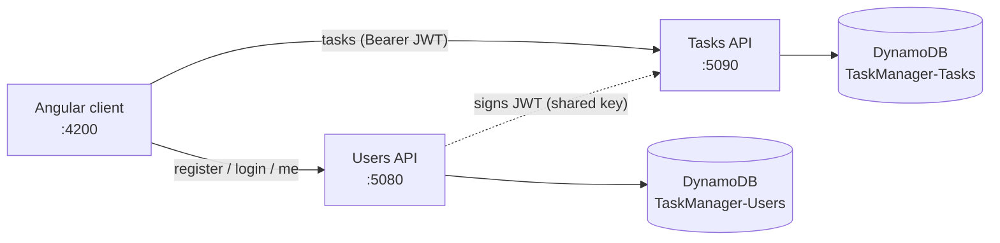
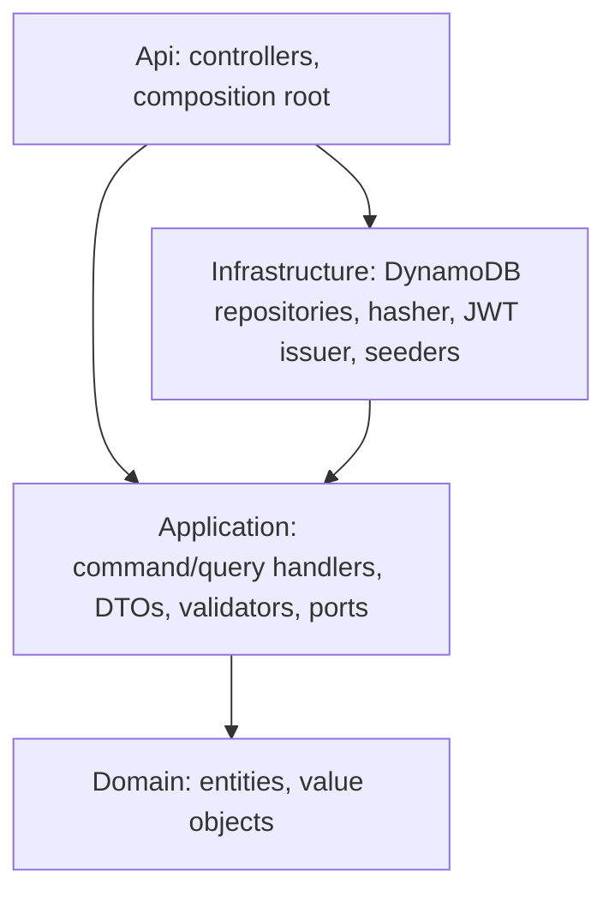
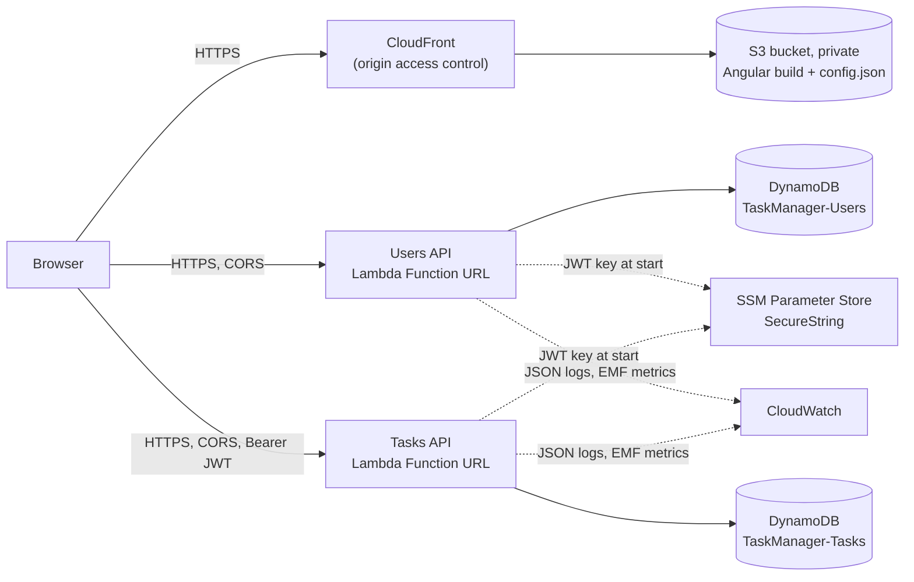

# TaskManager

A task-management application: users register, sign in, and create, list and update **their own** tasks. It is made of a **Users API**, a **Tasks API** (both ASP.NET Core on .NET 10), one **DynamoDB** table per API, and an **Angular 22** client.

Live Demo: https://d374jkz3g8l8ht.cloudfront.net

## Architecture



The Tasks API never reads the Users table. It trusts the `sub` claim of a JWT signed by the Users API with a shared signing key.

Each API follows Clean Architecture with CQRS-style use cases: Controller → command/query handler → Repository. Each use case is a command (changes state) or a query (read only) with one handler that implements `ICommandHandler` or `IQueryHandler`. Controllers inject the handler they need directly, so there is no mediator. There is no EF, Dapper or MediatR.



## Prerequisites

- .NET SDK 10.0.401 or newer (see `global.json`)
- Node.js LTS and npm
- Docker (DynamoDB Local and the backend integration tests)

## Quick start

```bash
# 1. DynamoDB Local on :8000
docker compose up -d

# 2. The SAME signing key (32+ characters) on BOTH APIs
dotnet user-secrets set Jwt:SigningKey "<32+ char value>" --project src/Users/TaskManager.Users.Api
dotnet user-secrets set Jwt:SigningKey "<32+ char value>" --project src/Tasks/TaskManager.Tasks.Api

# 3. Run the APIs (separate terminals). Development creates tables and seeds demo data.
dotnet run --project src/Users/TaskManager.Users.Api    # http://localhost:5080
dotnet run --project src/Tasks/TaskManager.Tasks.Api    # http://localhost:5090

# 4. Run the client
cd web && npm ci && npm start                           # http://localhost:4200
```

## Running tests

```bash
dotnet build TaskManager.slnx -warnaserror
dotnet test TaskManager.slnx

cd web
npx ng lint
npx ng test --watch=false
npx ng build
```

Repository integration tests use Testcontainers, which needs a current Docker (API 1.44 or newer). With an older Docker, start DynamoDB Local and point the tests at it:

```bash
docker compose up -d
DYNAMODB_TEST_ENDPOINT=http://localhost:8000 dotnet test TaskManager.slnx
```

Coverage (Domain and Application must stay at 80% line coverage or higher; CI enforces this):

```bash
dotnet test TaskManager.slnx --collect:"XPlat Code Coverage" --settings coverlet.runsettings --results-directory ./coverage-raw
dotnet tool restore
dotnet tool run reportgenerator "-reports:coverage-raw/**/coverage.cobertura.xml" "-targetdir:coverage-report" "-reporttypes:Html;TextSummary" "-assemblyfilters:+TaskManager.*.Domain;+TaskManager.*.Application"
```

## API overview

Interactive docs (Scalar): locally `http://localhost:5080/scalar/v1` and `http://localhost:5090/scalar/v1` (always on in Development), and `<api-url>/scalar/v1` on the deployed APIs (the API URLs are in the deploy job summary). Outside Development the docs are served only when `OpenApi:Enabled` is `true`, which the AWS stack sets; the OpenAPI document is at `/openapi/v1.json`. The deployed docs are public by design, so reviewers can browse the API without signing in; every endpoint except register, login still requires a token.

| API | Method and route | Auth | Notes |
|---|---|---|---|
| Users | `POST /api/v1/auth/register` | anonymous | `201`, `400`, `409` (email taken), `429`, `503` (concurrent registration of the same email; retry) |
| Users | `POST /api/v1/auth/login` | anonymous | `200` with `accessToken`, `400`, `401`, `429`, `503` (no client IP; hosting misconfiguration) |
| Users | `GET /api/v1/users/me` | JWT | current user; the client also uses it to validate a stored session |
| Tasks | `POST /api/v1/tasks` | JWT | `201`, `400`, `401` |
| Tasks | `GET /api/v1/tasks` | JWT | caller's tasks, newest first |
| Tasks | `GET /api/v1/tasks/{id}` | JWT | `404` for missing or another user's task |
| Tasks | `PUT /api/v1/tasks/{id}` | JWT | `200`, `400` (same rules as create; `status` required), `401`, `404` |
| Both | `GET /health`, `GET /health/ready` | anonymous | liveness and readiness (DynamoDB `DescribeTable`) |

## Project layout

```
src/BuildingBlocks/   SharedKernel (Result, Error, IClock), ApiCommon (web plumbing), Infrastructure.DynamoDb
src/Users/            Domain, Application, Infrastructure, Api
src/Tasks/            Domain, Application, Infrastructure, Api
tests/                one test project per src project, TaskManager.Testing (helpers), ArchitectureTests
web/                  Angular client (core/, layout/, features/, shared/)
infra/                AWS CDK app (C#), cdk.json, smoke-test.sh
docs/superpowers/     design spec and implementation plan
.github/workflows/    ci.yml (build, test, deploy), pr-review.yml
.github/scripts/      changed-artifacts.sh (which artifacts a push changed)
.claude/              rules/rules.md (collaborator rules), launch.json (dev-server configs)
```

## Deployment (AWS)

The app runs on AWS free-tier services only, defined with the AWS CDK in C# (`infra/TaskManager.Infra`, tested by `tests/TaskManager.Infra.Tests`).



| Piece | AWS service | Why this one (cost) |
|---|---|---|
| Users API, Tasks API | Lambda (`dotnet10`, arm64, 1024 MB) with a public **Function URL** | No API Gateway charge; Lambda's 1M requests/month are always free |
| Data | DynamoDB, provisioned **5 RCU / 5 WCU per table** | 10 + 10 is inside the always-free 25 / 25 |
| Web client | Private S3 bucket behind **CloudFront** | CloudFront's 1 TB / 10M requests are always free; the bucket holds a few MB |
| JWT signing key, demo password | **SSM Parameter Store SecureStrings** | Free (Secrets Manager costs $0.40 per secret per month) |
| Logs and metrics | CloudWatch Logs (7-day retention), 6 EMF custom metrics | Within the 5 GB and 10-metric free allowances |
| CI/CD sign-in | GitHub OIDC → IAM role | No AWS keys stored in GitHub |

Expected cost for this exercise: **$0 per month**.

### How deployment works

- **On every merge to `main`**, the `changes` job works out which artifacts changed (`users-api`, `tasks-api`, `web`, `infra`; shared code and build settings count for both APIs) since the **last successful production deployment** (GitHub records one each time the `deploy` job runs). Comparing against what is actually deployed, not just the previous commit, keeps changes from runs that GitHub cancelled (quick successive merges), that failed, or that skipped the deploy (for example before the AWS setup). With no successful deployment yet, everything counts as changed. If nothing deployable changed (for example a docs-only merge), nothing is deployed.
- Otherwise the `deploy` job runs after `backend`, `frontend` and `repo-hygiene` pass. It publishes both APIs deterministically, so unchanged code produces byte-identical output, builds the client and runs `cdk deploy`. CloudFormation then updates only the resources whose code or settings changed: an unchanged Lambda or client is left alone.
- **Manual deploy**: Actions → CI → Run workflow on `main`. The tests run first, then everything is deployed (unchanged resources are still skipped).
- After each deploy, `infra/smoke-test.sh` checks the live site (including a deep-link reload), `config.json`, both `/health/ready` endpoints, login and token rejection, both APIs' Scalar docs, and CORS from the site's origin. The job summary lists the site and API URLs.
- **Demo data**: on each cold start the APIs make sure the demo user `demo@taskmanager.dev` (private password from SSM) and its sample tasks exist. The login page does not show the demo option; reviewers sign in with the credentials you give them.
- Until the AWS setup below is done, the `deploy` job is skipped, so CI stays green.

### Teardown

```bash
cd infra && npx --yes aws-cdk@2.1148.1 destroy TaskManager TaskManager-GitHubOidc
aws ssm delete-parameters --region us-east-1 --names /taskmanager/jwt-signing-key /taskmanager/demo-password
```

Tables, bucket contents and log groups are deleted with the stack.

## CI and PR review

`.github/workflows/ci.yml` runs on every pull request, on pushes to `main`, and on demand:

- **backend**: restore, `dotnet build -warnaserror`, tests with coverage, and the 80% Domain + Application line-coverage gate.
- **frontend**: `npm ci`, `ng lint --max-warnings 0`, `ng test`, `ng build`.
- **repo-hygiene**: fails if any tracked file is a symbolic link.
- **changes** (pushes to `main` and manual runs): which deployable artifacts changed.
- **deploy** (`main` only, after the jobs above pass): deploys to AWS and smoke-tests the result; see [Deployment (AWS)](#deployment-aws). It also runs from Actions → CI → Run workflow.

`.github/workflows/pr-review.yml` has Claude review each PR with fresh eyes against `.claude/rules/rules.md`. It is comment-only: it never approves, resolves threads or merges, and a human does that.

## Known limitations

- **No email verification**: accounts are active immediately (Amazon SES sandbox friction; can be added as a later story).
- **No refresh tokens**: the access token lasts 60 minutes, then the user signs in again.
- **Token in `sessionStorage`**: simple across two separately hosted APIs, but exposed to XSS; an httpOnly cookie would resist it better.
- **No end-to-end browser test suite** (unit and integration tests only).
- **Browser console and wrong passwords**: a failed login returns `401` by design, and the browser itself logs "Failed to load resource: 401" for it. The app code emits no warnings or errors; the browser's own network log line cannot be suppressed without breaking the API contract.
- No pagination parameters on the list endpoint; no password reset.
- **Rate limits are per instance and per IP**: each warm Lambda instance keeps its own counters, so the effective limit grows with concurrency. In AWS the browser calls the Lambda Function URLs directly (no proxy), so the client IP is the real one and `ForwardedHeaders` stays unset. Behind a single proxy, set `ForwardedHeaders:KnownProxies` or `KnownNetworks`; multi-hop proxy chains are not supported.
- **Default AWS domains**: the site uses its `*.cloudfront.net` address and the APIs their `*.lambda-url.<region>.on.aws` addresses; there is no custom domain, WAF or API Gateway (all left out to stay in the free tier).
- **Demo password changes**: seeding never overwrites an existing demo user, so changing `/taskmanager/demo-password` later does not change the password of a demo user that already exists. To rotate it, delete the demo user's two items (`USER#11111111-1111-1111-1111-111111111111` and `EMAIL#demo@taskmanager.dev`) from `TaskManager-Users`; the next cold start recreates them.
